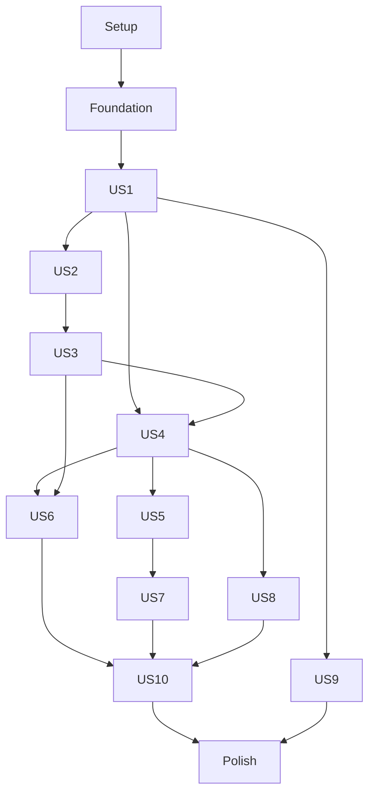

# Tasks: Environment Builder — основная версия

**Input**: design artifacts из `specs/001-environment-builder/`: [plan.md](plan.md), [spec.md](spec.md), [research.md](research.md), [data-model.md](data-model.md), [quickstart.md](quickstart.md), [documents](contracts/documents.md), [runtime](contracts/runtime.md), [UI](contracts/ui.md), пять JSON schemas и примеры в `contracts/examples/`.

**Prerequisites**: [конституция v1.0.0](../../.specify/memory/constitution.md) и [style guide](../../docs/design/style-guide.md). Исходная кодовая база отсутствует; пути ниже — создаваемые файлы. Фактическая Git-ветка `main`; этот workflow не меняет ветку.

**Scope**: US1–US10 обязательны для основной версии. P1/P2 задают порядок; MVP US1 — промежуточный offline increment, не сокращение полной поставки. Спецификация имеет приоритет над mockups.

**Tests**: включены по spec A-002 (обязательные принципы конституции), конституции VI/VIII и testing/acceptance contracts плана. Сначала написать failing tests на соответствующей границе; затем реализовать поведение и выполнить их. Core/VM без окна/live Docker/arbitrary sleeps; integration/UI/live qualification не подменять unit tests.

**Organization**: задачи сгруппированы по истории; общие contracts/persistence/pack backend находятся в earliest shared foundation. Каждая история проверяется на независимом заранее подготовленном store, без прохождения предыдущих сценариев через UI.

## Format: `[ID] [P?] [Story] Description`

- Каждая задача: `- [ ] Tnnn [P?] [USn?] действие с точным путём файла`.
- `[P]` означает допустимый параллельный запуск только после завершения перечисленных prerequisites и предыдущих обязательных checkpoints; разные файлы и независимые fixture stores обязательны.
- `[US1]`–`[US10]` есть только у задач своей истории; Setup/Foundational/Polish не имеют story label.
- Зависимости внутри описаний обязательны. Порядок ID — безопасный последовательный маршрут. Если пакет параллельных задач не указан, исполнять по порядку.
- Сохранённое состояние, runtime observation и operation outcome различаются; неизвестный процент не вычисляется, unknown/stale не считаются stopped/ready.

## Path Conventions

- Все исходные пути в задачах относительны корню репозитория `D:/Space/Personal/environment-builder`.
- Production: `src/EnvironmentBuilder.Core/`, `src/EnvironmentBuilder.Infrastructure/`, `src/EnvironmentBuilder.App/`; три assembly без дополнительных architectural layers.
- Tests: `tests/EnvironmentBuilder.UnitTests/`, `tests/EnvironmentBuilder.IntegrationTests/`, `tests/EnvironmentBuilder.UiTests/`.
- Demo: `demos/Requests.Api/`, `demos/Scheduler.Api/`, `demos/Reporting.Api/`, declarative fixtures вне app assemblies; acceptance scripts: `scripts/powershell/`.
- `artifacts/acceptance/<runId>/` — намеренная подстановка уникального run ID, не имя literal каталога; reports содержат actual evidence. Все destructive tests используют отдельные store/allowlisted IDs.

## Execution Gates

Не начинать user-story implementation до Foundational checkpoint. Каждый story checkpoint включает связанные unit/offline suites, targeted Release build/analyzers/format и соответствующую UI/Docker проверку при наличии prerequisites. Перед UI изменением использовать общие tokens/components; после изменения проверить обе темы и binding/resource errors. Не повторять полный soak после каждого локального изменения без причины.

Сбой/невозможность mandatory gate фиксируется как Failed/Blocked/Unverified/ManualPending и оставляет зависимую приёмку незавершённой. Отсутствие Engine/interactive desktop/LAN peer/участников не даёт pass. До полной release приёмки внутренние checkpoints не являются заявлением о готовой основной версии.
## Phase 1: Setup (Shared Infrastructure)

**Purpose / Goal**: Подготовить solution, фиксированные зависимости, test harness и общие WPF resources до экранов.

- [ ] T001 Создать `global.json`, `Directory.Build.props` и `.editorconfig`: SDK 10.0.402 с `rollForward=latestPatch`, C# 14, nullable, analyzers, warnings as errors, deterministic build и lock-file restore; не добавлять runtime frameworks сверх плана.
- [ ] T002 Создать `EnvironmentBuilder.sln` и проекты `src/EnvironmentBuilder.Core/EnvironmentBuilder.Core.csproj`, `src/EnvironmentBuilder.Infrastructure/EnvironmentBuilder.Infrastructure.csproj`, `src/EnvironmentBuilder.App/EnvironmentBuilder.App.csproj`: Core net10.0, остальные net10.0-windows, WPF App/WinExe, win-x64; App → Core и Infrastructure только через composition root, Infrastructure → Core (после T001).
- [ ] T003 Создать `Directory.Packages.props` с Central Package Management и точными версиями из plan/research: WPF-UI 4.3.0, CommunityToolkit.Mvvm 8.4.2, Lucide 6.2.1, DI/Sqlite/ProtectedData 10.0.13, xunit.v3 4.0.2, runner 4.0.1, Test SDK 18.11.0, FlaUI.UIA3 5.0.0, demo-only RabbitMQ.Client 7.2.2; разрешить необходимые transitive версии в `packages.lock.json` каждого проекта без wildcard (после T002).
- [ ] T004 Создать `tests/EnvironmentBuilder.UnitTests/EnvironmentBuilder.UnitTests.csproj`, `tests/EnvironmentBuilder.IntegrationTests/EnvironmentBuilder.IntegrationTests.csproj` и `tests/EnvironmentBuilder.UiTests/EnvironmentBuilder.UiTests.csproj`, добавить в `EnvironmentBuilder.sln`: Windows-target VM tests без окна, xUnit/TRX, категории `Category=Docker`/`Category=UI`, offline suite без live dependencies (после T003).
- [ ] T005 Создать `tests/EnvironmentBuilder.IntegrationTests/Support/IsolatedTestStore.cs`, `FaultController.cs` и `ScopedDockerFixture.cs`: уникальные child stores/test IDs, fake clock/process/HTTP, fault points до/после мутаций; Docker требует opt-in, manifest allowlist и production ownership cleanup, недоступная обязательная prerequisite при opt-in — blocked/failure, не skip (после T004).
- [ ] T006 [P] Создать `src/EnvironmentBuilder.App/Themes/Light.xaml` и `Dark.xaml` со всеми semantic Brush/Color/spacing/radius/icon tokens из `docs/design/style-guide.md`; WPF UI resources подключать перед overrides, отключить OS accent override, значимый Light TextTertiary на Canvas заменить существующим TextSecondary (после T003).
- [ ] T007 Создать `src/EnvironmentBuilder.App/Themes/Typography.xaml` и `Components.xaml`: Segoe UI Variable/fallback Segoe UI, общие Button/TextBox/ComboBox/DataGrid/TabControl/ScrollBar/ToolTip/CheckBox styles, Hover/Pressed/Selected/Focused/Disabled/error; theme resources применять через DynamicResource без HEX во Views (после T006).

**Checkpoint**: Solution/test harness/resources созданы; зависимости зафиксированы без wildcard.

---

## Phase 2: Foundational (Blocking Prerequisites)

**Purpose / Goal**: Реализовать общие typed contracts, persistence, безопасный pack backend, journal и реальные I/O seams. Эти backend-возможности нужны ранним историям; полные пользовательские сценарии библиотек остаются в US7/US8.

**CRITICAL**: эта фаза блокирует все истории. Foundation включает backend импорта пакетов, поскольку US2/US5 обязаны применять baseline до появления полной библиотеки US7; runtime не зависит от будущего P2 UI.

- [ ] T008 Сначала добавить failing contract/rule tests в `tests/EnvironmentBuilder.UnitTests/Contracts/DocumentRulesTests.cs` и `tests/EnvironmentBuilder.IntegrationTests/Persistence/DurableBoundaryTests.cs`: shape/runtime parity, canonical hashes, atomic writes, intent failure запрещает effect, result failure оставляет unknown; использовать схемы/примеры `specs/001-environment-builder/contracts/` как fixtures, schema validation выполнять только tooling с локальным resolver.
- [ ] T009 Создать общие Value/source/port/storage/endpoint/reference records в `src/EnvironmentBuilder.Core/Environments/ComponentValues.cs` по `common.schema.json`, включая все required/nullable/range/pattern constraints; сохранить правила модели дословно: «Secret-параметр содержит ссылку, значение в JSON запрещено», «default — loopback, LAN открывается явно для каждого порта», «Внешние source/input mounts только read-only»; port 1–65535, nullable hostPort, protocol tcp/udp, access loopback/network, purpose application/control, reference lengths/allowlists — строго по схеме. Source: «`infrastructure` допускает только image»; Parameters: «обязательность, тип и диапазоны проверяются локально»; Environment: «Явные literal/secret-reference значения; никакого произвольного кода или неограниченного шаблонизатора»; Storage: «Устойчивый локальный ID и container target»; Readiness: «`none`, `running`, `dockerHealth` либо `http` с ограничением ожидания». Добавить `src/EnvironmentBuilder.Core/Environments/InputReference.cs` для source path/Dockerfile/read-only input/image/secret/exact pack refs.
- [ ] T010 Создать `src/EnvironmentBuilder.Core/Environments/IsolatedEnvironment.cs`, `EnvironmentComponent.cs` и `ComponentDefinition.cs`: «Неизменяемый UUID окружения, независимый от имени и Compose project», «Неизменяемый UUID экземпляра внутри окружения; все зависимости и назначения baseline адресуются ему», «Положительный последовательный номер сохранённой конфигурации одного окружения; начинается с 1», «Непустое после trim имя и минимум один компонент; отображаемые имена могут совпадать.»; полные immutable definition snapshots, optional description, componentType target/infrastructure, contract namespace/version; name≤256, description≤4096, revision≤9007199254740991, instances≤100 (после T009). Version keys: «Целая версия внешнего формата; v1 принимается явно, другая версия не преобразуется предположительно»; «UUID и semver неизменяемой версии библиотечного описания, hash её содержимого»; «Служебные timestamps, observation, draft UI и runtime-результаты не создают конфигурационных изменений.» «Архив всех прежних документов и возврат данных к прежней ревизии не предусматриваются.»
- [ ] T011 Создать `src/EnvironmentBuilder.Core/Environments/ComponentDependency.cs` и `DependencyValidator.cs`: «Единственный сохранённый resolved graph — верхнеуровневый `IsolatedEnvironment.dependencies`», «`requirementId: null` обозначает явно добавленную пользователем дополнительную связь», «`condition` — `running`, `healthy` или `ready`»; проверять обе вершины, exact definition/version requirement, ровно одно обязательное назначение, no self-edge/duplicates/cycles, цепочку ошибки и явный выбор при неоднозначности (после T010).
- [ ] T012 Создать `src/EnvironmentBuilder.Core/SeedPacks/DataBaseline.cs` и `InitializationDefinition.cs` по initialization/environment schemas: «`seedPack` — `null` либо точный `{ id, version, contentHash }`», «два полностью одинаковых назначения в baseline отклоняются как дубль», «Step содержит устойчивый ID, endpoint ID конкретного назначения, relative path/method, literal/secret-ref headers, inline JSON или section body reference, ожидаемые statuses и необязательные JSON-pointer assertions, timeout и retry policy.»; mandatory snapshot ровно один раз с seedPack:null перед pack applications, ordered applications/steps; все required/length/enum/bounds из схем (после T010). «Назначение относится к одному instance ID.»; «Secret-reference IDs входят в описание, plaintext — нет.»
- [ ] T013 [P] Создать `src/EnvironmentBuilder.Core/SeedPacks/SeedPack.cs` и `SeedSection.cs`: «`SeedSection` содержит `id`, `title`, относительный `path` NDJSON, `sha256`, `bytes`, `recordCount`», «Объявленный initializer entry содержит `path`, `bytes`, `sha256`», «Доменные имена секций не фиксируются в приложении»; exact identity/version/contentHash и contract compatibility, title/theme/purpose/sections/initializer bounds и uniqueness по seedpack.schema.json (после T009). Pack fields: «точную identity/version/contentHash, title/theme/purpose, `compatibility: [{ contractId, versions }]`, измеренные размеры/counts и declared sections/initializers».
- [ ] T014 Реализовать `src/EnvironmentBuilder.Infrastructure/Imports/StrictDocumentReader.cs`: UTF-8 strict JSON, root kind/schemaVersion=1, duplicate/unknown keys, invalid Unicode, comments/trailing commas и depth>32 отклонять до записи; environment≤4 MiB, component/initializer/manifest≤1 MiB; соблюдать все shape constraints пяти published schemas без runtime JSON Schema dependency/network resolver (после T012, T013).
- [ ] T015 [P] Реализовать `src/EnvironmentBuilder.Core/Environments/CanonicalJson.cs`: «Canonical JSON рекурсивно сортирует имена свойств UTF-16 ordinal, сохраняет порядок массивов, кодирует UTF-8 без незначащих пробелов с минимальным JSON escaping», «Для произвольного inline JSON сохраняется лексема числового токена»; вычислять configuration/definition/initializer/baseline/application hashes и manifest hash без contentHash, не включая runtime/DB timestamps (после T012, T013). `baselineHash`: «Производный SHA-256 нормализованного эффективного baseline, включая назначения экземплярам и точные initializer/package hashes»; `applicationHash`: «Производный SHA-256 одного baseline application; различает применение одного initializer к разным пакетам в одном экземпляре».
- [ ] T016 Реализовать `src/EnvironmentBuilder.Core/Environments/EnvironmentValidator.cs`: «Необъявленный parameter key также отклоняется», «Коллизия явно заданного environment key с `parameterDefinitions[].environmentVariable` является structural error», «`none` не допускает собственных initializer/baseline или `ready` dependency»; required/type/Int64/boolean/secret-ref validation, infrastructure image-only, port scope overlap, unsafe/overlapping mounts, endpoint bindings; missing path/image/secret/pack — readiness issue, доказанный доступный pack conflict — semantic error (после T011, T015).
- [ ] T017 Реализовать `src/EnvironmentBuilder.Core/SeedPacks/InitializationValidator.cs`: target contract/instance/section equality, уникальные step IDs, endpoint mapping, GET/HEAD body:none, relative request targets без decoded traversal/authority/CRLF, безопасные headers/JSON pointers; mandatory timeout1–600s, steps≤1000, statuses100–599, retry none→1 / idempotent|key→1–3 с safetyEvidence и key header; «Ссылка на section разрешается только внутри назначенного verified SeedPack.» (после T016).
- [ ] T018 [P] Создать `src/EnvironmentBuilder.Core/Operations/Operation.cs`, `OperationPlan.cs`, `OwnedResource.cs`, `DataGeneration.cs` и `DataApplicationRecord.cs`: kind container/network/volume, immutable plan/confirmation hash/candidate, точные IDs/ownership/consumers/generation/inputs; состояния «`planned` / `awaitingConfirmation`», «`running`», «`cancelRequested`», «`reconciling` / `needsAttention`», «`succeeded`», «`failed` / `partiallyCompleted` / `cancelled`»; «Локальные времена записываются как UTC instant; UI применяет локальную зону.» (после T017). Ledger поля: «installation/environment/component IDs, resource lifetime UUID, kind (`container`, `network`, `volume`), creation revision, data generation, desired attributes и actual runtime identity»; для containers/networks — «actual Docker ID». Operation: «ID, environment ID, kind, state, timestamps, исходную revision/config hash, immutable `OperationPlan`, component/stage progress, sanitized results, cancellation/close request и unresolved remnants»; Step: «ordered ID, action/target, durable intent, state, timestamps, actual identity/result и error». `operationId`, `stepId`: «UUID операции и устойчивый ID её этапа; переживают навигацию и перезапуск процесса».
- [ ] T019 Определить только реальные seams в `src/EnvironmentBuilder.Core/Abstractions/IEnvironmentStore.cs`, `IOperationStore.cs`, `IRuntimeAdapter.cs`, `IInputResolver.cs`, `ISeedPackStore.cs`, `ISecretVault.cs`, `IInitializationTransport.cs` и `IClock.cs`: async Task/cancellation/progress/result contracts, no WPF/Process/SQLite dependencies в Core; перечислить ownership/lifetime каждого boundary (после T018). Runtime seam расширять только реально реализуемыми named methods текущего slice; не добавлять NotImplementedException/заглушки будущих Stop/delete методов.
- [ ] T020 [P] Реализовать `src/EnvironmentBuilder.Infrastructure/Security/LocalPathResolver.cs`: «`LocalPathReference` имеет переносимый вид `local-path://<alias>`», «`LocalPathMapping` локально связывает alias с выбранным абсолютным filesystem path и временем проверки»; root containment, context/Dockerfile-relative paths, запрет UNC/drive/ADS/../reparse escapes, read-only source handling; missing mapping не заменять одноимённой папкой (после T019).
- [ ] T021 [P] Реализовать `src/EnvironmentBuilder.Infrastructure/Security/DpapiSecretVault.cs` и `SecretContext.cs`: «`SecretReference` имеет вид `secret://<uuid>`», «`SecretRecord` связывает его с пользовательской подписью и DPAPI `CurrentUser` ciphertext», «plaintext не хранится в configuration, operation journal, preview или export»; unresolved ref блокирует affected runtime, короткоживущий secret context с явным disposal (после T019).
- [ ] T022 Реализовать `src/EnvironmentBuilder.Infrastructure/Security/SecretRedactor.cs` и `SanitizedDiagnostics.cs`: redaction known values/JSON-URI escaped forms/chunk boundaries/sensitive fields до memory/UI/disk; observation удерживает context весь tail, при отсутствии secret set вывод не открывается; «Пять файлов по 4 MiB, redaction до записи»; raw HTTP bodies/private env/Compose contents не логировать (после T021).
- [ ] T023 [P] Реализовать `src/EnvironmentBuilder.Infrastructure/Persistence/AppDataDirectory.cs` и `SingleWriterLease.cs`: default `%LOCALAPPDATA%/EnvironmentBuilder/`, explicit `ENVIRONMENTBUILDER_DATA_DIR`, canonical-root OS mutex, current-user ACL private directories; второй writer получает понятный результат, потеря writer/write capability запрещает новые effects (после T019). `installationId`: «Локальный UUID установки/data directory; участвует в доказательстве владения ресурсами, не экспортируется».
- [ ] T024 Создать `src/EnvironmentBuilder.Infrastructure/Persistence/Migrations/001_Initial.sql` и `DatabaseMigrator.cs` со всеми таблицами/PK/FK из data-model §9: AppMetadata, Environments, ComponentDefinitions, ApplicationSettings, LocalPathMappings, Secrets, SeedPacks, PackEntries, ContentBlobs, PackageReferences, DataGenerations, DataApplicationRecords, Operations, OperationSteps, ResourceLedger; immutable version keys, ciphertext без plaintext column, no cascade unresolved evidence; «Database schema version независима от `schemaVersion` JSON» (после T023). Ограничения ключей дословно: Environments — «environment ID PK», ComponentDefinitions — «`(definitionId, version)` PK», ApplicationSettings — «key PK», LocalPathMappings — «alias PK», Secrets — «secret reference PK», SeedPacks — «`(packId, version)` PK», PackEntries — «`(packId, version, path)` PK», ContentBlobs — «SHA-256 PK», DataGenerations — «generation ID PK, environment FK», Operations — «operation ID PK», OperationSteps — «`(operationId, stepId)` PK», ResourceLedger — «resource lifetime UUID PK»; PackageReferences — «owners — saved environment и recovery-relevant operation», DataApplicationRecords — «FK на generation/environment».
- [ ] T025 Реализовать `src/EnvironmentBuilder.Infrastructure/Persistence/SqliteWorker.cs`: один dedicated worker, WAL/synchronous=FULL/foreign_keys, короткие serial transactions; «Нельзя держать DB transaction открытой во время Docker, HTTP, preview ожидания или пользовательского подтверждения.»; transactional migrations/unsupported DB version без изменения, native sqlite_version≥3.51.3 либо проверенный backport; corrupt database не заменять пустой (после T024).
- [ ] T026 Реализовать `src/EnvironmentBuilder.Infrastructure/Persistence/EnvironmentStore.cs` и `ComponentLibraryStore.cs`: atomic JSON/hash/summary/reference commits, independent row reading с unreadable/unsupported items, failed write сохраняет последнюю корректную row; «Component IDs внутри authoritative JSON проверяются domain validator до транзакции», «Библиотечная версия неизменяема: изменение создаёт новую версию»; saved effective snapshots не пересчитывать по defaults (после T025, T014).
- [ ] T027 Реализовать `src/EnvironmentBuilder.Infrastructure/Persistence/OperationStore.cs` и `ResourceLedgerStore.cs`: операции/steps/confirmed plan/candidate/intent/result/remnants durable отдельно; «`started` фиксируется commit до любого изменяющего Docker/HTTP вызова», «`observedResult` фиксируется отдельным commit после effect и сверки»; сохранять unresolved create/delete evidence и recovery pack references (после T026).
- [ ] T028 Реализовать `src/EnvironmentBuilder.Infrastructure/Persistence/DataApplicationStore.cs` поверх shared `src/EnvironmentBuilder.Core/Operations/DataGeneration.cs` и `DataApplicationRecord.cs`: «`validity` имеет состояния `active`, `invalidated`, `retired`», «Долговременный ключ успеха: `(environmentId, componentId, dataGenerationId, baselineHash, applicationHash, initializerHash, stepId)`», «`pending` → `started` → `succeeded` / `failed` / `unknown`»; stable key/attempt/timestamps/status/assertion/sanitized error без bodies, invalidation durable до первой deletion attempt, Stop/Start generation прежняя (после T027). Generation содержит «ID, environment ID, baselineHash, время выделения/инвалидации, `validity`, причину инвалидации и operation ID перехода»; StepAttempt сохраняет «state, stable idempotency key, attempt number, timestamps, accepted status/assertion outcome и sanitized error code». `dataGenerationId`: «UUID поколения runtime-данных; не равен revision или baselineHash».
- [ ] T029 [P] Реализовать `src/EnvironmentBuilder.Infrastructure/Persistence/ContentBlobStore.cs`: «`ContentBlob` — immutable app-owned content по SHA-256», private staging/promotion, verified size/hash/relative paths, DB references и active leases; orphan cleanup только внутри verified private root без живых refs; corrupt/missing payload диагностировать, derived index можно перестроить по verified blob (после T025).
- [ ] T030 Реализовать `src/EnvironmentBuilder.Infrastructure/Imports/SeedPackImporter.cs` и `NdjsonReader.cs`: ZIP≤512 MiB compressed/2 GiB expanded/256 entries, section≤256 MiB, actual byte/hash/count verification; только manifest/declared sections/initializers, reject traversal/rooted/UNC/ADS/links/case collision/executable/nested archive/undeclared entries; NDJSON object/line≤64 KiB, без blank lines, streaming byte-offset index; никаких process/HTTP effects (после T014, T029, T017).
- [ ] T031 Реализовать `src/EnvironmentBuilder.Infrastructure/Persistence/SeedPackStore.cs`: «Тот же identity/version/hash даёт no-op, другой hash под тем же identity/version — ошибку без изменения библиотеки», staging→validation→promotion→atomic pack/entries/refs commit; «Незавершённая операция также удерживает выбранные blobs и candidate references до разрешения recovery.»; сохранить refs saved environments/recovery-relevant operations (после T030, T026).
- [ ] T032 Реализовать `src/EnvironmentBuilder.Core/Operations/DurableEffectRunner.cs`: durable intent→effect→read-only observation→result commit, fault boundary перед/после каждого этапа, intent failure=zero effects, result-write failure останавливает scheduling и оставляет unknown; operation journal не содержит request/response bodies, secrets/raw process output (после T018, T027, T028).
- [ ] T033 Реализовать `src/EnvironmentBuilder.Core/Operations/OperationCoordinator.cs`: app-owned operations, mutation lock по environment ID, duplicate submission возвращает существующую operation, независимые environment locks, safe cancellation points и блокировка новых effects при writer loss/pending close; navigation cancellation не отменяет операцию (после T032).
- [ ] T034 [P] Создать `src/EnvironmentBuilder.App/Shell/NavigationService.cs`, `DialogService.cs`, `ThemeService.cs` и `Components/PageHeader.xaml`, `ContextPanel.xaml`, `StatusBar.xaml`: task-based UI interactions без controls во VM, route/draft IDs, Dispatcher batches, сворачиваемая панель, runtime Light/Dark без пересоздания VM; диалоги возвращают focus (после T007).
- [ ] T035 Создать `src/EnvironmentBuilder.App/App.xaml`, `App.xaml.cs`, `Composition/ServiceRegistration.cs` и `Shell/MainWindow.xaml`: явный DI root для storage/vault/coordinator/screen scopes, четыре маршрута и стартовый список окружений, доступные имена Lucide-команд, startup/offline storage error states; незавершённый journal не выдавать за stopped/success (после T033, T031, T034, T022).
- [ ] T036 Дополнить и выполнить `tests/EnvironmentBuilder.IntegrationTests/Persistence/DurableBoundaryTests.cs`, `Imports/UnsafeSeedPackTests.cs` и `Security/SecretBoundaryTests.cs`: row-vs-DB corruption/unknown versions, duplicate imports, disk/write faults, stage promotion without DB commit, held refs/leases, mutex conflict, chunked/escaped sentinel leaks; проверить schema/runtime parity всего contract corpus и запрет effects в import/read paths (после T035).

**Checkpoint**: Typed contracts, safe storage/import/journal и shared shell готовы; foundational tests проверяют zero-effect и durable boundaries.

---

## Phase 3: User Story 1 — Описать и сохранить окружение (P1, MVP)

**Purpose / Goal**: Создать, проверить и сохранить описание с полным contextual Compose preview без Docker, восстановив draft/list state после навигации.

**Independent Test**: При недоступном Docker создать окружение из подготовленных descriptors, проверить field errors/auto dependencies/per-port loopback, сохранить и перезапустить приложение. Состав/effective settings/revision 1/preview совпадают; containers/process/init HTTP effects=0; missing inputs допускают save; dirty navigation сохраняет либо отменяет draft по выбору.

### Tests for US1 (сначала, ожидаемый red)

- [ ] T037 [P] [US1] Сначала добавить failing contract tests для common/component/environment JSON, deterministic Compose/preview и UI command states в `tests/EnvironmentBuilder.UnitTests/Environments/AuthoringContractTests.cs`: полные schemas/examples, malformed/duplicate/unknown fields, snapshot defaults, per-instance DAG/ports/baseline и readiness-vs-structural errors.
- [ ] T038 [P] [US1] Сначала добавить failing headless VM tests в `tests/EnvironmentBuilder.UnitTests/ViewModels/EnvironmentEditorTests.cs` и `EnvironmentListTests.cs`: loading/empty/search/filter/error, disabled reasons, dirty Save/Discard/Stay/Escape, list selection/scroll, create return и сохранение draft при theme switch.
- [ ] T039 [P] [US1] Сначала добавить failing offline integration tests в `tests/EnvironmentBuilder.IntegrationTests/Authoring/OfflineAuthoringTests.cs`: create/save/reopen/failed write, missing paths/secrets/images/packs, все runtime spies=0 для выборов папки/save/import/preview; 1000-row fixtures без подмены missing metrics нулём.
### Implementation for US1

- [ ] T040 [US1] Реализовать `src/EnvironmentBuilder.Core/Environments/EnvironmentDraft.cs` и `CreateEnvironmentService.cs`: новые environment/instance UUID, materialized defaults, explicit ambiguous dependency resolution с reason, mandatory baseline snapshots, atomic revision1+generation+refs+summary; «Создание сохраняет revision 1 без Docker, сборки и наполнения.» (после T037, T038, T039).
- [ ] T041 [US1] Реализовать чистый `src/EnvironmentBuilder.Core/Environments/ComposeCompiler.cs` и `ComposeModel.cs`: полный состав, ID-based service/project names, typed parameter→env binding, safe escaping literal `$`, managed volumes/read-only staging placeholders, явные 127.0.0.1/0.0.0.0 per-port bindings и auto loopback control mapping; redacted preview/runtime render используют один effective model без Compose process/default reapplication (после T040).
- [ ] T042 [US1] Создать `src/EnvironmentBuilder.Core/Environments/PreviewSnapshot.cs` и `src/EnvironmentBuilder.Infrastructure/Docker/PreviewInputCapture.cs`: «`PreviewSnapshot` связывает environment/revision, canonical effective spec, hashes initializer/pack, ID secret references, source/build fingerprints и известные image IDs/digests», «Offline unknown указан явно», «Token не содержит secret values.»; file hashes читать без исполнения, image identity брать лишь из известного observation, отсутствие Docker не вызывает lookup (после T041, T020).
- [ ] T043 [P] [US1] Реализовать `src/EnvironmentBuilder.App/Features/Environments/EnvironmentListViewModel.cs`: async load/search по имени+описанию/filter status+type/expand/selection+scroll, отдельные empty/no-results/row-corrupt/store-error/offline states, immutable IDs и readable disabled reasons, только доступные измерения (после T038).
- [ ] T044 [P] [US1] Реализовать `src/EnvironmentBuilder.App/Features/Environments/EnvironmentEditorViewModel.cs`: поля имени/описания/component source/parameters/env/secret refs/dependencies/ports/storage/baseline, auto dependency reason/explicit instance picker, live structural errors и отдельные readiness issues, folder picker без effects, save command через CreateEnvironmentService (после T040, T042).
- [ ] T045 [US1] Создать `src/EnvironmentBuilder.App/Features/Environments/EnvironmentListPage.xaml` и `EnvironmentRow.xaml`: recycling virtualization, доступные expand/filter/actions/long-name detail, loading/empty/error/offline и timestamps, новый saved item выделяется без сброса фильтров/позиции (после T043).
- [ ] T046 [US1] Создать `src/EnvironmentBuilder.App/Features/Environments/EnvironmentEditorPage.xaml` и `ComponentEditor.xaml`: полный nested editor, read-only IDs, target image/build и infrastructure image-only, port access на каждой записи, baseline/dependency instance selectors, error-summary→field focus, scroll при1280×720 DIP (после T044).
- [ ] T047 [P] [US1] Создать `src/EnvironmentBuilder.App/Features/Environments/ComposePreviewViewModel.cs` и `ComposePreviewPage.xaml`: redacted content/revision/unknown inputs и возврат к прежнему editor/environment context, copy только sanitized preview; no runtime calls (после T042).
- [ ] T048 [US1] Создать `src/EnvironmentBuilder.App/Features/Environments/DirtyDraftGuard.cs` и `Components/DirtyDraftDialog.xaml`, связать с `Shell/NavigationService.cs`: Save/Не сохранять/Остаться, Escape/close=Stay, failure Save не навигирует, draft/route/focus сохраняются; editor и list routes подключить в `Composition/ServiceRegistration.cs` (после T046, T045, T047).
- [ ] T049 [P] [US1] Создать подготовленные неизвестные приложению component/environment JSON fixtures в `demos/fixtures/authoring/environment.json` и `components.json` и `tests/EnvironmentBuilder.IntegrationTests/Support/FixtureStoreBuilder.cs` через production readers/store: target+infrastructure, missing inputs, names/errors и1000-row store; содержимое импортируется harness, не зашивается в app (после T040).
- [ ] T050 [US1] Добавить и выполнить `tests/EnvironmentBuilder.UiTests/AuthoringSmokeTests.cs`: keyboard create/preview/save/reopen/dirty choices, две темы без VM recreation, no binding/resource errors; выполнить US1 unit/offline suites, а без interactive desktop оставить UI gate unverified (после T048, T049).

**Checkpoint**: US1 функционально завершена; выполнить independent test на отдельном prepared fixture. Незавершённые обязательные gates не отмечать passed.

---

## Phase 4: User Story 2 — Запустить окружение и исследовать состояние (P1)

**Purpose / Goal**: Выполнить согласованный preflight/pinned Start с dependencies и baseline, показать фактическое состояние в Inspect, сохранив работающие компоненты при ошибке.

**Independent Test**: На подготовленном multi-component store запустить demo, проверить readiness/initialization/logs/metrics/endpoints; отказ одного компонента оставляет остальные running и Inspect доступным. Source/image delta, в том числе unknown→resolved, требует отдельного подтверждения; отказ даёт zero runtime/data mutations. Повтор команды/навигация сохраняют operation ID.

### Tests for US2 (сначала, ожидаемый red)

- [ ] T051 [P] [US2] Сначала добавить failing Docker CLI/runtime contract tests в `tests/EnvironmentBuilder.IntegrationTests/Docker/DockerAdapterContractTests.cs`: ArgumentList/no-shell, simultaneous streams, sanitized env, endpoint/Engine ID pinning, minimum/API/Compose2/5.4/current5 capability output fixtures, unknown output и remote/Windows modes blocked. Также проверить shared ownership verifier: matching names/labels без ledger/actual identity недостаточно, copied volume labels/incarnation mismatch/missing evidence/foreign stopped consumer/network attachment дают blocker.
- [ ] T052 [P] [US2] Сначала добавить failing initialization HTTP contract tests в `tests/EnvironmentBuilder.IntegrationTests/Initialization/HttpContractTests.cs`: basePath preservation/decoded traversal/headers, loopback mapping, redirects/proxy/cookies/credentials disabled, section streaming, statuses/assertions/204/HEAD, bounded retry/response и unsafe unknown dispatch.
- [ ] T053 [P] [US2] Сначала добавить failing Core/VM tests в `tests/EnvironmentBuilder.UnitTests/Operations/StartTests.cs` и `ViewModels/InspectTests.cs`: DAG running/healthy/ready, runtimeReady→baseline→applicationReady без hidden cycle, duplicate clicks, readiness:none, partial Start без cleanup, session disposal/late updates и unknown/missing/zero/partial aggregates. Покрыть Wait/Cancel/Return обычного закрытия, dirty guard и ожидание durable safe point до завершения процесса.
- [ ] T054 [P] [US2] Сначала добавить integration/fault tests в `tests/EnvironmentBuilder.IntegrationTests/Operations/StartFaultTests.cs`: preflight всех inputs до mutation, отказ delta=zero effects, source capture races/tag drift/pinned launch, intent/result failures, ambiguity safe/unsafe HTTP, failure/cancel после каждого этапа без auto Stop/cleanup (после T005).
### Implementation for US2

- [ ] T055 [P] [US2] Создать `demos/Requests.Api/Requests.Api.csproj`, `Program.cs` и `Dockerfile`: самостоятельный .NET10 target, durable `/data`, health/bootstrap/seed/counts/business mutation endpoints, publish RabbitMQ events, documented server-side durable idempotency key deduplication; routes остаются demo contracts (после T003).
- [ ] T056 [P] [US2] Создать `demos/Scheduler.Api/Scheduler.Api.csproj`, `Program.cs` и `Dockerfile`: самостоятельный .NET10 consumer/producer RabbitMQ, отдельный `/data`, readiness/bootstrap/seed/counts и observable exchange/failure behavior без зависимости на менеджер (после T003).
- [ ] T057 [P] [US2] Создать `demos/Reporting.Api/Reporting.Api.csproj`, `Program.cs` и `Dockerfile`: самостоятельный .NET10 RabbitMQ consumer, собственные persisted projections, health/init/counts и deterministic business-data probe; без общей БД трёх сервисов (после T003).
- [ ] T058 [US2] Создать runnable descriptors/initializers в `demos/descriptors/environment.json`, `requests.component.json`, `scheduler.component.json`, `reporting.component.json`, `rabbitmq.component.json` и small/medium/100000-record inputs с manifest в `demos/seedpacks/small/manifest.json`, `medium/manifest.json`, `large/manifest.json`, включая RabbitMQ image-only, exact contracts/instance dependencies/readiness/pack hashes; добавить demo projects/locks в `EnvironmentBuilder.sln`, библиотека app не содержит их имён/маршрутов (после T055, T056, T057, T031).
- [ ] T059 [US2] Реализовать `src/EnvironmentBuilder.Infrastructure/Docker/DockerProcessRunner.cs`: проверенный absolute docker.exe, ArgumentList/UseShellExecute=false/no console, async stdout+stderr, bounded/redacted outputs до sink, explicit env allowlist/clean DOCKER_*/COMPOSE_* routing; secret plaintext не в args/names/labels (после T051).
- [ ] T060 [US2] Реализовать `src/EnvironmentBuilder.Infrastructure/Docker/DockerCapabilityProbe.cs`: explicit read-only requested probe выбранного local npipe endpoint, Windows11 serviced24H2+/WSL2/linux amd64/Engine≥28/API≥1.48/Compose≥2.24.6 major2|5 и нужные flags/output; sentinel Compose без mutation, Engine ID фиксировать/перепроверять, unknown formats блокируют affected capability (после T059).
- [ ] T061 [US2] Реализовать `src/EnvironmentBuilder.Infrastructure/Docker/RuntimeInputCapture.cs`: полный read-only capture source/Dockerfile/ignore/args/build-secret refs/readOnlyInput bytes в private stable staging, hashes фактически скопированных bytes, reject races/reparse escapes, staged mounts lease до удаления контейнера; image IDs/digests и platform pinning без подмены tag (после T042, T059).
- [ ] T062 [US2] Реализовать `src/EnvironmentBuilder.Core/Operations/ResourceOwnershipVerifier.cs` и `src/EnvironmentBuilder.Infrastructure/Docker/ResourceConsumerReader.cs`: «Перед удалением проверяются ledger, exact identity, labels и все consumers, включая stopped containers», «Несовпадение, shared mount или foreign consumer блокирует затронутый deletion», «Ресурс того же имени после внешнего пересоздания не считается прежним.»; network attachments и полное incarnation evidence, unknown не равно empty (после T051, T054, T059, T060).
- [ ] T063 [US2] Реализовать `src/EnvironmentBuilder.Core/Operations/StartPreflight.cs`: проверить все component paths/secrets/exact packs/providers/graph/ports/existing resource ownership/image identities до первой runtime/data mutation; сравнить PreviewSnapshot и вернуть отдельный concrete delta/new-token confirmation, unknown image допускает preflight, отсутствие review token требует полного review (после T060, T061, T062).
- [ ] T064 [US2] Реализовать `src/EnvironmentBuilder.Infrastructure/Docker/PrivateRuntimeFiles.cs` и `ImagePreparation.cs`: Compose/env/BuildKit secret files только после разрешения операции и с current-user ACL, build из staged inputs/platform final stage, pull/build→pinned ID journal, launch --no-build --pull never; secret files lifetime/cleanup/failure видимы, images/cache не owned deletable data (после T063).
- [ ] T065 [US2] Реализовать `src/EnvironmentBuilder.Infrastructure/Docker/DockerRuntimeAdapter.cs`: resource create intent→точный Docker create/up→inspect→ledger actual identity для containers/networks/volumes; «для volume — exact name, lifetime UUID/labels и engine-observed `CreatedAt`, `Driver`, `Scope`, `Options`», «V1 поддерживает только local driver/local scope без custom options»; eb-envGUID/c-instanceGUID, installation/environment/resource/component/revision/generation labels, reject foreign name collision, Compose detached --no-deps из runtime contract (после T064).
- [ ] T066 [US2] Реализовать `src/EnvironmentBuilder.Core/Operations/ReadinessEvaluator.cs` и `src/EnvironmentBuilder.Infrastructure/Initialization/LoopbackEndpointResolver.cs`: none/running/dockerHealth/http с bounded waits, health не подменять running; inspected owned loopback control mapping/auto host port, HTTP2xx readiness; ready зависит от всех baseline applications, initializer ждёт runtimeReady, не собственного applicationReady (после T065, T052).
- [ ] T067 [US2] Реализовать `src/EnvironmentBuilder.Infrastructure/Initialization/HttpInitializationTransport.cs`: GET/HEAD/POST/PUT/PATCH/DELETE, controlled loopback TCP endpoint/basePath, redirects/proxy/cookies/ambient credentials disabled, обычная HTTPS certificate validation; allowed headers и literal/streamed section body, response≤1 MiB, status/JSON-pointer structural equality без coercion, assertions-empty допускает non-JSON/204/HEAD, no body logging (после T066).
- [ ] T068 [US2] Реализовать `src/EnvironmentBuilder.Core/SeedPacks/BaselineExecutor.cs` и `InitializationRetryPolicy.cs`: durable Started→dispatch→assertions→Succeeded, полный success key с applicationHash, mandatory-before-pack order, skipped durable successes текущей active generation, stable idempotency key, retry408/429/502/503/504/transient transport только с safetyEvidence≤3 в общем timeout с bounded backoff/Retry-After; unsafe ambiguous=unknown и block dependents (после T067, T028).
- [ ] T069 [US2] Реализовать `src/EnvironmentBuilder.Core/Operations/StartEnvironmentService.cs`: полная preflight/delta confirmation/input pinning, bounded DAG scheduling, images→owned runtime→readiness→baseline с DurableEffectRunner; failure прекращает новые stages, reconciles accepted effects и сохраняет running components без автоматического Stop/cleanup; success только при всех обязательных условиях (после T068, T064, T054).
- [ ] T070 [P] [US2] Создать `src/EnvironmentBuilder.Core/Environments/EnvironmentObservation.cs` и `Measurement.cs`: «freshness (`current`, `stale`, `unknown`)», «Component observation содержит Docker status, отдельный health (`notConfigured` отличается от `healthy`), ports/addresses и полученные measurements», «`Measurement` — value/unit/time или явно missing reason», «Aggregates содержат completeness/count покрытия»; lifecycle/readiness/init/operation result отдельно (после T053). Observation содержит «environment ID, session ID, checkedAt/lastSuccessfulAt».
- [ ] T071 [US2] Реализовать `src/EnvironmentBuilder.Infrastructure/Docker/DockerObservationReader.cs`: ledger+actual inspect, expected/owned/missing/unexpected/foreign drift, all container consumers и network attachments, unavailable→unknown/stale timestamps, внешняя потеря/замена persisted resource инвалидирует generation, container IP не выдаётся за Windows URL (после T070, T065). ResourceObservation хранит «actual state, consumers, lastCheckedAt и результат ownership check».
- [ ] T072 [P] [US2] Реализовать `src/EnvironmentBuilder.Infrastructure/Docker/LogObservationSession.cs`: verified exact IDs, bounded --tail/--timestamps/--follow/--since без --details, relevant secret context весь tail; «До 10 000 строк или 8 MiB на observation; 32 MiB на приложение, одна строка до 16 KiB; truncation/drop counters видимы»; budget включает ingestion queues, cancel/await/dispose и session/env guards (после T071, T022).
- [ ] T073 [P] [US2] Реализовать `src/EnvironmentBuilder.Infrastructure/Docker/MetricSampler.cs`: «300 samples/component с интервалом 2 s; отсутствующие значения не заполняются нулями», no overlapping probes, explicit JSON stats format/verified IDs, invariant decimal/binary units, approximate CLI resolution, CPU может>100%, I/O cumulative/rates только между valid samples, partial/stale aggregate semantics (после T071).
- [ ] T074 [US2] Реализовать `src/EnvironmentBuilder.App/Features/Environments/InspectViewModel.cs` и `EnvironmentCommands.cs`: app-owned operation progress/ID, initial ack/indeterminate stages, refresh only observation, component status/log/address commands+disabled reasons, одна session с cancel/await/dispose до замены, Dispatcher batches/late result guards (после T069, T072, T073).
- [ ] T075 [US2] Создать `src/EnvironmentBuilder.App/Features/Environments/InspectPage.xaml`, `Components/OperationProgress.xaml` и `InputDeltaDialog.xaml`, подключить Start/Inspect/Compose/progress в list/editor и `Composition/ServiceRegistration.cs`: реальные status/health/metrics/timestamps/truncation, delta review и cancel, partial failure без false ready, return context и keyboard actions (после T074).
- [ ] T076 [US2] Реализовать `src/EnvironmentBuilder.App/Shell/ShutdownCoordinator.cs`, `Components/CloseOperationsDialog.xaml` и view-only Closing bridge в `Shell/MainWindow.xaml.cs` до первого runtime handoff: dirty draft guard, Wait/Cancel/Return, block new mutations, safe points по всем active operations, durable result/reconciliation до единственного Shutdown, noncancellable reason; window не скрывается в background (после T075, T048, T053).
- [ ] T077 [US2] Добавить и выполнить opt-in `tests/EnvironmentBuilder.IntegrationTests/Docker/StartInspectDockerTests.cs` и `tests/EnvironmentBuilder.UiTests/InspectSmokeTests.cs` на test IDs: demo+baseline exchange, source/image drift cancel, component/init failure leaves running, real mapping/log/metric semantics, two simultaneous environments; сохранить actual qualification/evidence, unavailable Engine/desktop не считать passed (после T076, T058).

**Checkpoint**: US2 функционально завершена; выполнить independent test на отдельном prepared fixture. Незавершённые обязательные gates не отмечать passed.

---

## Phase 5: User Story 3 — Остановить и продолжить с сохранёнными данными (P1)

**Purpose / Goal**: Выполнить подтверждённый Stop и повторный Start без потери пользовательских данных и повторов успешного наполнения.

**Independent Test**: На готовом окружении изменить business data и выполнить20 Stop/Start: sentinel data сохраняются, durable successful initialization повторяется0 раз. Неполный inspect/disconnect не подтверждает stopped и блокирует edit/clear/refresh; NeverStarted остаётся отдельным display status.

### Tests for US3 (сначала, ожидаемый red)

- [ ] T078 [P] [US3] Сначала добавить failing runtime Stop contract tests в `tests/EnvironmentBuilder.IntegrationTests/Docker/StopContractTests.cs`: exact owned IDs/reverse DAG, graceful timeout, stopped verification по всем owned leftovers, no remove/data/init-marker mutations, disconnect/unknown не дают ConfirmedQuiescent.
- [ ] T079 [P] [US3] Сначала добавить failing Core/VM tests в `tests/EnvironmentBuilder.UnitTests/Operations/StopResumeTests.cs`: повторный Start использует ту же generation/success tuple, missing/replaced volume инвалидирует readiness, empty verified resource set допускает guard, unknown/paused/restarting блокируют destructive commands и поясняют причину.
- [ ] T080 [P] [US3] Сначала добавить opt-in regression test20 циклов и stop-fault cases в `tests/EnvironmentBuilder.IntegrationTests/Docker/StopStartPersistenceTests.cs`: данные/counts/attempt history до и после, interrupted stop/restart, соседняя копия неизменна; fixtures создаёт harness без UI (после T058).
### Implementation for US3

- [ ] T081 [US3] Реализовать `src/EnvironmentBuilder.Core/Operations/QuiescenceGuard.cs`: «Guard `ConfirmedQuiescent` допускает также verified empty resource set никогда не запускавшегося окружения», «Он означает фактически проверенное отсутствие running/restarting/paused/unknown owned containers и conflict, отдельно от display NeverStarted/Stopped», «Docker unavailable не подтверждает guard.»; повторная проверка под environment lock (после T079).
- [ ] T082 [US3] Реализовать `src/EnvironmentBuilder.Core/Operations/StopEnvironmentService.cs` и адресный stop в `src/EnvironmentBuilder.Infrastructure/Docker/DockerStopAdapter.cs`: verified container IDs, reverse dependency order, journaled graceful timeout, post-inspect всех owned containers, persisted data/spec/generation/success markers сохраняются (после T081, T078).
- [ ] T083 [US3] Подключить active-generation/resource-incarnation проверку в `src/EnvironmentBuilder.Core/Operations/StartEnvironmentService.cs` и `DataGenerationGuard.cs`: прежний durable success не удостоверяет missing/recreated volume, ordinary Stop/Start не меняет revision/generation; явно показать blocker и recovery action (после T082).
- [ ] T084 [US3] Подключить Stop/Start/refresh-observation availability к `src/EnvironmentBuilder.App/Features/Environments/EnvironmentCommands.cs` и `InspectPage.xaml`, register services в `Composition/ServiceRegistration.cs`; выполнить stop/resume suites и20-cycle Docker test, сохранить blocked evidence при недоступном Engine (после T083, T080).

**Checkpoint**: US3 функционально завершена; выполнить independent test на отдельном prepared fixture. Незавершённые обязательные gates не отмечать passed.

---

## Phase 6: User Story 4 — Изменить остановленное окружение с новой ревизией (P1)

**Purpose / Goal**: Сохранить любое изменение существующего окружения только после подтверждённой полной cleanup, сохранив прежнюю authoritative revision при partial failure.

**Independent Test**: На stopped и saved-never-started fixture проверить name-only и component/settings edits, unchanged Save, cancel и stale confirmation. Успех сохраняет тот же ID/revision+1/new generation/stopped; partial cleanup сохраняет old snapshot и invalidated generation с deleted/remnants, draft остаётся доступным.

### Tests for US4 (сначала, ожидаемый red)

- [ ] T085 [P] [US4] Сначала добавить failing edit/ownership contract tests в `tests/EnvironmentBuilder.IntegrationTests/Operations/EditContractTests.cs`: canonical no-op, name-only destructive plan, candidate publication only after verified cleanup, same ID/+1, old snapshot при DB/result fault, missing resource already-absent без повторной deletion.
- [ ] T086 [P] [US4] Сначала добавить failing VM tests в `tests/EnvironmentBuilder.UnitTests/ViewModels/DestructiveEditTests.cs`: ConfirmedQuiescent availability, dirty Save path, exact name/ID/revision/resources/data warning, cancellation preserves draft/spec/data, stale plan требует нового подтверждения, partial outcome не объявляет saved.
- [ ] T087 [P] [US4] Сначала добавить opt-in fault/isolation matrix в `tests/EnvironmentBuilder.IntegrationTests/Docker/OwnershipDeletionTests.cs`: две копии+foreign lookalike, copied labels, copied-label recreated volume с другим CreatedAt/Driver/Scope/Options, missing incarnation evidence, stopped foreign consumer/network attachment, Engine/revision/plan drift; affected deletion blocked без force (после T082).
### Implementation for US4

- [ ] T088 [US4] Реализовать `src/EnvironmentBuilder.Core/Operations/DestructivePlanBuilder.cs`: exact resources/data/generation/Engine ID/revision/consumers/stop requirements/candidate, plan hash и ConfirmationRecord; «Материальное изменение ресурсов/состава/входов делает старое подтверждение непригодным: требуется новый plan/confirmation.»; external sources/images/imports исключить из удаления (после T062, T085, T087). OperationPlan содержит «точные resources/data, необходимые stop/temporary start stages, input fingerprints, baseline/generation, expected ownership/state, последствия и candidate specification при edit»; ConfirmationRecord фиксирует «hash показанного плана и время явного решения».
- [ ] T089 [P] [US4] Реализовать `src/EnvironmentBuilder.Core/Operations/VerifiedCleanupExecutor.cs` и exact removal в `src/EnvironmentBuilder.Infrastructure/Docker/DockerRemovalAdapter.cs`: invalidate generation durable до первого destructive attempt, проверить plan/identity/stop/consumers перед каждым эффектом, удалить stopped containers→verified volumes→private network, post-observe absent; no prune/down-v/rmi/remove-orphans/force/label-only removal (после T088).
- [ ] T090 [US4] Реализовать `src/EnvironmentBuilder.Infrastructure/Persistence/EditFinalization.cs`: «После verified полной cleanup один commit candidate revision +1, fresh generation, refs/indexes и operation result; до commit текущая specification прежняя»; result-commit failure сохраняет candidate/evidence для явной финализации после сверки, не повторяет cleanup (после T089).
- [ ] T091 [US4] Реализовать `src/EnvironmentBuilder.Core/Operations/EditEnvironmentService.cs`: canonical no-op до планирования, неизменяемые existing instance IDs, ConfirmedQuiescent+per-env lock, plan/confirmation/revalidation/cleanup/final commit, partial/cancel сохраняют authoritative snapshot и перечень effects/remnants, no rollback promise (после T090).
- [ ] T092 [P] [US4] Создать `src/EnvironmentBuilder.App/Components/DestructivePlanDialog.xaml` и `DestructivePlanViewModel.cs`: accessible warning, exact identity/resources/data loss/temporary stages, stale-token review, keyboard cancel/focus; пустой scope всё равно требует confirmation при реальном изменении saved environment (после T088, T086).
- [ ] T093 [US4] Подключить existing edit route/save к `src/EnvironmentBuilder.App/Features/Environments/EnvironmentEditorViewModel.cs`, `EnvironmentCommands.cs` и `Composition/ServiceRegistration.cs`: guard/readonly ID, candidate/draft остаётся при cancellation/failure, successful Save возвращает к same-ID item; выполнить edit contract/VM/fault suites и SC-005 procedures (после T091, T092).

**Checkpoint**: US4 функционально завершена; выполнить independent test на отдельном prepared fixture. Незавершённые обязательные gates не отмечать passed.

---

## Phase 7: User Story 5 — Очистить данные или восстановить baseline (P1)

**Purpose / Goal**: Развести read-only observation, clear и refresh; применять подтверждённый baseline после полной preflight и возвращать успешный refresh в stopped.

**Independent Test**: На независимых prepared stores выполнить read-only observation,10 clear и10 refresh. Observation не меняет business/configuration; clear сохраняет spec/revision/baseline и сбрасывает data/markers; refresh восстанавливает expected counts без duplicates и заканчивается verified stopped. Missing pack/provider блокирует до удаления, partial/cancel показывает фактические steps/остатки/running temporary components.

### Tests for US5 (сначала, ожидаемый red)

- [ ] T094 [P] [US5] Сначала добавить failing runtime clear/refresh contract tests в `tests/EnvironmentBuilder.IntegrationTests/Operations/DataResetContractTests.cs`: all-store plan, preflight before deletion, spec/revision/baseline invariants, generation reset, mandatory-only/empty baseline, temporary endpoints/Start/Stop и unknown final Stop запрещает success.
- [ ] T095 [P] [US5] Сначала добавить failing VM tests в `tests/EnvironmentBuilder.UnitTests/ViewModels/DataResetCommandsTests.cs`: три разные подписи/последствия, ConfirmedQuiescent/ownership/provider blockers, destructive confirmation, partial restoration и отдельный явный Stop, без auto rollback/stop при init failure.
- [ ] T096 [P] [US5] Сначала добавить opt-in10 clear+10 refresh/fault/isolation tests в `tests/EnvironmentBuilder.IntegrationTests/Docker/DataResetDockerTests.cs`: expected counts/zero duplicates, missing pack/apply contract before deletion, failure/cancel каждого этапа, preserved foreign/second environment и unchanged revision (после T089, T068).
### Implementation for US5

- [ ] T097 [P] [US5] Реализовать `src/EnvironmentBuilder.Infrastructure/Persistence/DataResetFinalization.cs`: «После cleanup один commit fresh generation и retirement прежней; clear завершается, refresh продолжает init с новым journal»; очистка old success readiness без изменения authoritative configuration/revision/baseline, invalidated partial state и refs сохраняются (после T094).
- [ ] T098 [US5] Реализовать `src/EnvironmentBuilder.Core/Operations/ClearEnvironmentDataService.cs`: ConfirmedQuiescent, точный all-owned-storage plan и освобождающие containers, confirmation/revalidation через shared cleanup, verified generation reset→stopped/uninitialized; missing resources handled по факту без расширения scope (после T097).
- [ ] T099 [P] [US5] Реализовать `src/EnvironmentBuilder.Core/SeedPacks/BaselinePreflight.cs`: проверка всех immutable blobs/compatibility/initializer-entry equality/secrets/endpoints/providers/instance readiness до cleanup, missing apply contract недоступен; «доступность всех inputs проверяется до удаления данных»; full refreshed plan включает concrete temporary components/control ports/Stop (после T094, T063).
- [ ] T100 [US5] Реализовать `src/EnvironmentBuilder.Core/Operations/RefreshEnvironmentDataService.cs`: baseline preflight→confirmed shared cleanup→new generation→temporary pinned runtime→BaselineExecutor→verify expected outcomes→verified Stop; empty/no-pack baseline поддержать, final Stop failure=partial/unknown, init failure оставляет работающие temporary components до явной команды (после T098, T099, T082).
- [ ] T101 [US5] Подключить «Обновить состояние», «Очистить данные», «Восстановить baseline (refresh данных)» к `src/EnvironmentBuilder.App/Features/Environments/EnvironmentCommands.cs`, `EnvironmentListPage.xaml`, `InspectPage.xaml` и `Composition/ServiceRegistration.cs`: разные commands/tooltips/availability/plans/outcomes; observation вызывает только reader (после T100, T095).
- [ ] T102 [US5] Выполнить reset unit/offline/Docker suites и независимые SC-006/007 сценарии, записать outcome/counts/revision/generation/remnants и actual stopped proof в `artifacts/acceptance/<runId>/reports/data-reset.json`; недоступные Engine/UI gates оставить blocked/unverified (после T101, T096).

**Checkpoint**: US5 функционально завершена; выполнить independent test на отдельном prepared fixture. Незавершённые обязательные gates не отмечать passed.

---

## Phase 8: User Story 6 — Удалить окружение с контролем остатков (P1)

**Purpose / Goal**: Удалить только подтверждённые owned ресурсы и описание после полного успеха; partial delete оставляет видимую tombstone с безопасным повтором.

**Independent Test**: Удалить выбранное окружение из двух работающих копий при foreign container/shared lookalike/source tree. Сначала verified Stop, чужое и sources неизменны; отказ удаления volume оставляет видимые deleted/remnants и повтор после нового plan, already-absent scope безопасен.

### Tests for US6 (сначала, ожидаемый red)

- [ ] T103 [P] [US6] Сначала добавить failing delete/tombstone contract tests в `tests/EnvironmentBuilder.IntegrationTests/Operations/DeleteContractTests.cs`: stop-before-removal, confirmed exact scope, atomic finalization/refs release только при verified absence, interrupted delete и повтор уже отсутствующего ресурса без повторной destructive команды.
- [ ] T104 [P] [US6] Сначала добавить failing VM tests в `tests/EnvironmentBuilder.UnitTests/ViewModels/DeleteEnvironmentTests.cs`: name+ID/data-loss plan, cancel zero mutation, tombstone остаётся в списке с remnants/retry reason, stale token/foreign consumer blocks, удалённое selection корректно снимается.
- [ ] T105 [P] [US6] Сначала добавить opt-in fault/isolation tests в `tests/EnvironmentBuilder.IntegrationTests/Docker/DeleteIsolationTests.cs`: running selected copy→Stop→cleanup, отказ volume removal/result commit/crash между stages, foreign lookalike/copy-label/shared volumes/source files/second copy не изменены (после T089).
### Implementation for US6

- [ ] T106 [US6] Создать `src/EnvironmentBuilder.Core/Operations/DeletionTombstone.cs` и `src/EnvironmentBuilder.Infrastructure/Persistence/DeleteFinalization.cs`: «`DeletionTombstone` сохраняет environment ID/последний snapshot, plan и ledger remnants до verified отсутствия всех scoped ресурсов», «После полного удаления terminal history может сохранить только sanitized summary без живых resource/blob references.»; unresolved history не удалять cascade (после T103).
- [ ] T107 [US6] Реализовать `src/EnvironmentBuilder.Core/Operations/DeleteEnvironmentService.cs`: confirmed plan→при необходимости verified Stop→shared cleanup→final absence reconciliation→atomic live-description/refs/tombstone finalization; failure/cancel сохраняет visible tombstone, retry требует актуальной сверки/confirmation без расширения scope (после T106, T082).
- [ ] T108 [US6] Подключить delete/retry/remnants detail в `src/EnvironmentBuilder.App/Features/Environments/EnvironmentCommands.cs`, `EnvironmentListViewModel.cs`, `EnvironmentListPage.xaml` и `Composition/ServiceRegistration.cs`, используя shared destructive dialog; description не исчезает до полного успеха (после T107, T104).
- [ ] T109 [US6] Выполнить delete unit/offline/fault/Docker suites и записать isolation/remaining resources/cleanup evidence в `artifacts/acceptance/<runId>/reports/delete.json`; подтвердить отсутствие любых global cleanup/image/source mutations и отсутствие скрытой partial tombstone (после T108, T105).

**Checkpoint**: US6 функционально завершена; выполнить independent test на отдельном prepared fixture. Незавершённые обязательные gates не отмечать passed.

---

## Phase 9: User Story 7 — Импортировать пакет и наполнить целевой сервис (P2)

**Purpose / Goal**: Дать библиотеку внешних immutable SeedPacks, bounded offline preview, exact version selection и понятное решение для неоднозначного наполнения; использовать уже работающий safe importer/BaselineExecutor.

**Independent Test**: Импортировать пакеты разных тем/объёмов при отключённом Docker, повторить same/conflicting version imports, просмотреть100000-record pack постранично≤2s до первой страницы без процессов/HTTP. Назначить конкретный pack конкретному instance и применить; success не повторяется, unsafe unknown требует решения. Удаление referenced version заблокировано с owners.

### Tests for US7 (сначала, ожидаемый red)

- [ ] T110 [P] [US7] Сначала добавить failing seedpack/document/preview contract tests в `tests/EnvironmentBuilder.IntegrationTests/SeedPacks/SeedPackContractTests.cs`: schema/runtime parity, ZIP paths/limits/metadata vs actual hashes/counts, canonical content identity вне compression/timestamps, identity conflict, missing sections/initializer compatibility, atomic import и reference-held delete.
- [ ] T111 [P] [US7] Сначала добавить failing VM tests в `tests/EnvironmentBuilder.UnitTests/ViewModels/SeedPackLibraryTests.cs`: import progress/error/no partial item, content-driven sections, paging/truncation/cancel/selection, exact version compatibility, referenced owners и per-instance apply/unsafe Unknown decision.
- [ ] T112 [P] [US7] Сначала добавить bounded/performance+zero-effect tests в `tests/EnvironmentBuilder.IntegrationTests/SeedPacks/PreviewBoundsTests.cs`:100000 records, page≤100 records/256 KiB, record≤64 KiB/cache≤8 MiB, cursor continuation/eviction, no process/HTTP, first-page timings отдельно от import/index build (после T110).
### Implementation for US7

- [ ] T113 [P] [US7] Реализовать `src/EnvironmentBuilder.Infrastructure/Imports/SeedPreviewReader.cs` и `src/EnvironmentBuilder.Core/SeedPacks/SeedPreviewPage.cs`: verified blob+derived byte-offset index seek, content-defined sections/cursor, bounded read/render/cache, явный truncation/continuation; «100 records либо 256 KiB/page, record до 64 KiB; cache 8 MiB»; text never XAML/HTML/code (после T112).
- [ ] T114 [P] [US7] Реализовать `src/EnvironmentBuilder.Core/SeedPacks/DeleteSeedPackService.cs` и transactional release в `src/EnvironmentBuilder.Infrastructure/Persistence/SeedPackStore.cs`: «References сохранённых окружений блокируют удаление используемой версии с перечислением окружений», незавершённые operations/candidates/leases также удерживают refs; удалять unreferenced blobs только в private content directory (после T110).
- [ ] T115 [US7] Реализовать `src/EnvironmentBuilder.Core/SeedPacks/BaselineSelectionService.cs`: exact compatible pack+initializer snapshot по instance ID, declared section/target compatibility, mandatory init сохраняется, unavailable apply contract блокирует выбор/refresh, новая версия не заменяет выбор; сохранённое окружение меняется только через EditEnvironmentService (после T114, T091).
- [ ] T116 [US7] Реализовать `src/EnvironmentBuilder.Core/SeedPacks/ResolveUnknownInitializationService.cs`: после read-only verification явные решения признать проверенный результат/повторить с последствиями/начать новый confirmed refresh; unsafe step без safety не переигрывается, stable key tuple прежний при retry, dependent steps ждут durable success (после T068, T111).
- [ ] T117 [US7] Реализовать `src/EnvironmentBuilder.App/Features/SeedPacks/SeedPackLibraryViewModel.cs` и `SeedPackPreviewViewModel.cs`: async import/list/remove/owners, measured metadata/theme/purpose/version/compatibility, dynamic sections/bounded paging и UI progress без fake percentage, no Docker dependency (после T113, T114).
- [ ] T118 [US7] Создать `src/EnvironmentBuilder.App/Features/SeedPacks/SeedPackLibraryPage.xaml` и `SeedPackPreview.xaml`: только import внешнего ZIP, readable empty/error/no-section/large/truncated states, keyboard paging и owner links; добавить selector в `Features/Environments/EnvironmentEditorPage.xaml`, unknown-step dialog в `Components/UnknownInitializationDialog.xaml`, register services (после T117, T115, T116).
- [ ] T119 [US7] Добавить и выполнить `tests/EnvironmentBuilder.IntegrationTests/Docker/SeedPackApplicationTests.cs` и `tests/EnvironmentBuilder.UiTests/SeedPackSmokeTests.cs`: два pack applications с одним initializer не делят success, два instances не делят успех, lost response safe vs unsafe, offline UI preview и delete refs; записать SC-009/011 evidence в `artifacts/acceptance/<runId>/reports/seedpacks.json` (после T118).

**Checkpoint**: US7 функционально завершена; выполнить independent test на отдельном prepared fixture. Незавершённые обязательные gates не отмечать passed.

---

## Phase 10: User Story 8 — Добавить собственный компонент и настроить defaults (P2)

**Purpose / Goal**: Создавать/импортировать неизвестные декларативные definitions, управлять aliases/secret refs/defaults и явно применять изменения к snapshot, поддерживая несколько instances одного definition.

**Independent Test**: Через форму и import добавить неизвестный target с dependency/parameter/readiness/init; infrastructure build отклоняется. Создать два instances с отдельными IDs/settings/storage/baseline, разрешить неоднозначную dependency явно. Изменить library/defaults: существующий snapshot прежний до подтверждённого editor update.

### Tests for US8 (сначала, ожидаемый red)

- [ ] T120 [P] [US8] Сначала добавить failing component/defaults document tests в `tests/EnvironmentBuilder.IntegrationTests/Components/ComponentLibraryContractTests.cs`: все schema/semantic constraints, immutable id/version/hash/no-op/conflict, library/default update без mutation existing snapshots, import effects=0.
- [ ] T121 [P] [US8] Сначала добавить failing headless tests в `tests/EnvironmentBuilder.UnitTests/ViewModels/ComponentSettingsTests.cs`: form/import одинаковый typed contract, field errors, target image/build vs infrastructure image-only, duplicate instance identity, explicit dependency picker, defaults apply через destructive edit, aliases/vault UI не раскрывают values.
### Implementation for US8

- [ ] T122 [US8] Реализовать `src/EnvironmentBuilder.Core/Environments/ComponentLibraryService.cs`: validated create/import immutable definition versions, same key/hash no-op/conflict error, complete defaultSource/parameterDefinitions/defaultEnvironment/defaultPorts/defaultStorage/endpoints/readiness/dependencyRequirements/nullable initialization по схемам, новые versions не подменяют snapshots (после T120).
- [ ] T123 [P] [US8] Создать `src/EnvironmentBuilder.Core/Environments/ApplicationDefaults.cs` и `src/EnvironmentBuilder.Infrastructure/Persistence/ApplicationSettingsStore.cs`: «`ApplicationDefaults` хранит локальные начальные значения новых форм и UI preferences в отдельном документе», «Новое окружение получает копию выбранных эффективных значений», «Изменение библиотеки/defaults не пересчитывает сохранённые snapshots»; versioned UI/defaults JSON+LocalPathMappings, secrets только DPAPI vault refs (после T122).
- [ ] T124 [P] [US8] Реализовать `src/EnvironmentBuilder.App/Features/Settings/ComponentDefinitionEditorViewModel.cs`: source/parameter type+required+secret+nullable default/environment binding/ports/storage/endpoints/readiness/requirements/init fields, strict import diagnostics и new-version conflict handling без service-name веток (после T122, T121).
- [ ] T125 [US8] Реализовать `src/EnvironmentBuilder.App/Features/Settings/SettingsViewModel.cs`: defaults/theme/library/alias mapping/secret reference management, plaintext не bound/persisted вне краткого ввода vault, explicit snapshot update selection в editor сохраняет old settings до confirmed edit; theme choice не пересоздаёт route/VM (после T123).
- [ ] T126 [US8] Дополнить `src/EnvironmentBuilder.Core/Environments/EnvironmentDraft.cs` и `src/EnvironmentBuilder.App/Features/Environments/EnvironmentEditorViewModel.cs`: второй instance всегда new UUID, отдельные effective fields/managed storage, exact requirement bindings и baseline target, неоднозначность требует выбора; explicit defaults/definition update создаёт draft diff и использует обычный edit protocol (после T125, T124, T091).
- [ ] T127 [US8] Создать `src/EnvironmentBuilder.App/Features/Settings/SettingsPage.xaml` и `ComponentDefinitionEditor.xaml`, source/default/alias/vault dialogs и register services в `Composition/ServiceRegistration.cs`; keyboard error navigation, secrets только refs в отображаемых списках, local build option не предлагается infrastructure (после T126).
- [ ] T128 [P] [US8] Создать `demos/fixtures/fourth-service/Program.cs`, `Dockerfile`, `component.json`, `initialization.json` и `seedpack/manifest.json` с независимым generic HTTP service fixture и пользовательскими descriptor/init/SeedPack, а также `demos/fixtures/two-instances/environment.json` с разными settings/dependencies/storage; fixtures не require изменения app assemblies и проверяют разные application success keys (после T122, T058).
- [ ] T129 [US8] Добавить и выполнить `tests/EnvironmentBuilder.IntegrationTests/Docker/UnknownComponentTests.cs` и `tests/EnvironmentBuilder.UiTests/SettingsSmokeTests.cs`: unknown-service import/form, multiple instances isolation/baseline/dependency behavior, defaults preservation и explicit destructive update; записать FR-019/SC-013 evidence в `artifacts/acceptance/<runId>/reports/custom-components.json` (после T127, T128).

**Checkpoint**: US8 функционально завершена; выполнить independent test на отдельном prepared fixture. Незавершённые обязательные gates не отмечать passed.

---

## Phase 11: User Story 9 — Перенести конфигурацию без секретов и данных (P2)

**Purpose / Goal**: Экспортировать dedicated portable configuration и импортировать независимую копию с перечнем missing local inputs без implicit defaults/эффектов.

**Independent Test**: Экспортировать environment с secret ref/local build/pack, проверить отсутствие secret values/path mappings/data/journal/observation. В чистом store импорт создаёт новые environment+instance IDs/revision1 и remapped dependencies/baseline, все missing refs перечислены. Collision не меняет existing record; corrupt/unsupported import ничего не создаёт.

### Tests for US9 (сначала, ожидаемый red)

- [ ] T130 [P] [US9] Сначала добавить failing environment transfer contract tests в `tests/EnvironmentBuilder.IntegrationTests/Imports/EnvironmentTransferContractTests.cs`: dedicated export allowlist, missing vs proven-incompatible pack checks, embedded snapshots, ID collision/remap, unknown version/corrupt/duplicate/unsafe fields atomic rejection, zero process/container/HTTP effects.
- [ ] T131 [P] [US9] Сначала добавить failing VM/security tests в `tests/EnvironmentBuilder.UnitTests/ViewModels/EnvironmentTransferTests.cs`: import issues с pointers/instance IDs без подстановки defaults, save permitted, launch blocked по известным missing inputs; secret sentinel scan export/clipboard/dialog/error, cancel file operations без partial record.
### Implementation for US9

- [ ] T132 [US9] Реализовать `src/EnvironmentBuilder.Infrastructure/Imports/EnvironmentExportWriter.cs` и dedicated DTO в `src/EnvironmentBuilder.Core/Environments/EnvironmentExport.cs`: только environment schema fields со snapshots и secret/path refs; исключить plaintext/DPAPI/native path mappings/runtime files/data/ledger/observations/journal/derived local metadata, atomic destination write (после T130).
- [ ] T133 [US9] Реализовать `src/EnvironmentBuilder.Core/Environments/ImportEnvironmentService.cs`: полный strict/semantic validation до commit, «Импорт всегда создаёт независимое окружение с новым ID и revision 1; внутренние instance IDs и адресующие их ссылки согласованно переназначаются.»; exact snapshots/settings сохранить, missing pack manifest checks deferred readiness, доказанный conflict отклонить, create environment/generation/refs/summary atomically (после T132).
- [ ] T134 [US9] Создать `src/EnvironmentBuilder.Infrastructure/Imports/ImportedInputIssueReader.cs`: полный список local alias/secret/exact pack missing и image identity unknown без processes/registry/network; известное отсутствие и unknown различать, последующий explicit runtime preflight разрешает image, defaults не заменять (после T133). «Ошибки локализации/доступа хранятся отдельно с code, field path, объяснением и временем проверки; в экспорт не входят.»
- [ ] T135 [US9] Создать `src/EnvironmentBuilder.App/Features/Environments/EnvironmentTransferViewModel.cs` и `ImportEnvironmentDialog.xaml`, подключить file import/export commands/issue resolution links в `EnvironmentListPage.xaml` и `Composition/ServiceRegistration.cs`; новый imported ID выделяется, snapshot остаётся доступным offline (после T134, T131).
- [ ] T136 [US9] Выполнить transfer/offline/security suites и добавить UI import/export smoke в `tests/EnvironmentBuilder.UiTests/TransferSmokeTests.cs`: clean-store roundtrip/new IDs/remapped baseline, corrupted row не скрывает другие окружения, failed save сохраняет last good revision; записать sanitized transfer evidence в `artifacts/acceptance/<runId>/reports/transfer.json` (после T135).

**Checkpoint**: US9 функционально завершена; выполнить independent test на отдельном prepared fixture. Незавершённые обязательные gates не отмечать passed.

---

## Phase 12: User Story 10 — Диагностировать проблемы и восстановить наблюдение (P2)

**Purpose / Goal**: Показать read-only диагностику и сверку после disconnect/crash, дать явные безопасные recovery choices и закончить обычное закрытие только после durable результата активных работ.

**Independent Test**: Подготовить port conflict/unfinished intent, отключить Docker и перезапустить: descriptions доступны, observations unknown/stale с временем, journal/remnants видны. Восстановить Docker/изменить container внешне и обновить observation: actual drift виден, destructive/unsafe init replay=0. Обычное Close предлагает Wait/Cancel/Return, объясняет noncancellable stage и ждёт safe points+result commits.

### Tests for US10 (сначала, ожидаемый red)

- [ ] T137 [P] [US10] Сначала добавить failing recovery/runtime contract tests в `tests/EnvironmentBuilder.IntegrationTests/Recovery/RecoveryContractTests.cs`: unfinished create/delete/edit/init intents, effect-without-result, generation validity/resource replacement, Engine unavailable/changed ID, read-only reconciliation без automatic destructive/unsafe HTTP replay и candidate finalization без repeated cleanup.
- [ ] T138 [P] [US10] Сначала добавить failing VM tests в `tests/EnvironmentBuilder.UnitTests/ViewModels/DiagnosticsRecoveryTests.cs` и `ShutdownTests.cs`: port/path/ownership/capability results, distinct read/fix actions, stale/unknown/last-check, Wait/Cancel/Return плюс dirty draft/Escape, noncancellable safe-point reason, failed result persistence запрещает закрытие.
- [ ] T139 [P] [US10] Сначала добавить exhaustive opt-in fault/restart tests в `tests/EnvironmentBuilder.IntegrationTests/Docker/CrashRecoveryMatrixTests.cs`: forced process exit до/после каждого mutating Docker/HTTP stage для Start/Stop/Edit/Clear/Refresh/Delete и init send/success commit, startup observations/remnants/no false stopped/success/rollback, two-copy isolation (после T107, T100).
### Implementation for US10

- [ ] T140 [US10] Реализовать `src/EnvironmentBuilder.Core/Operations/StartupReconciler.cs`: прочитать unfinished operations/ledger/application Started, сравнить Engine/actual resources/records, convert незакрытый started→unknown, сохранить actual/unknown/remnants/generation drift без automatic mutation/replay; descriptions доступны при offline Docker (после T137).
- [ ] T141 [US10] Реализовать `src/EnvironmentBuilder.Core/Operations/RecoveryDecisionService.cs`: явные resume/finish verified edit finalization/retry tombstone workflows после fresh ownership/plan confirmation, unsafe initializer choices через ResolveUnknownInitializationService; old snapshot authoritative до atomic publish, reconciliation само не разрешает destructive replay (после T140, T116, T090, T106).
- [ ] T142 [P] [US10] Реализовать `src/EnvironmentBuilder.Infrastructure/Security/PrivateFileRecovery.cs`: startup orphan secret/runtime/staging cleanup лишь после сверки owners/leases/active interrupted ops, private-root containment; unresolved failures видны sanitized, read-only mounts lease не удалять пока используется контейнером (после T140, T064).
- [ ] T143 [P] [US10] Реализовать `src/EnvironmentBuilder.Core/Operations/DiagnosticsService.cs` и `src/EnvironmentBuilder.Infrastructure/Docker/PortAvailabilityProbe.cs`: explicitly requested read-only Docker/Compose matrix/capability/input/path/port/ownership checks, safe pointer/instance/stage/actionable reasons, unknown images допускают preflight; открытие Diagnostics не выполняет repair/build/pull/init/delete (после T140).
- [ ] T144 [US10] Реализовать `src/EnvironmentBuilder.Infrastructure/Security/DiagnosticReportWriter.cs`: dedicated sanitized report DTO versions/probes/operation/ownership summaries/times с redaction до memory/disk, без secrets/bodies/native command env/private files; bounded diagnostic disk logs по runtime contract (после T143, T142).
- [ ] T145 [US10] Реализовать `src/EnvironmentBuilder.Core/Operations/DiagnosticActions.cs`: только описанные explicit действия resolve local alias/secret refs/open editor/refresh observation/review recovery/launch preflight, с понятными последствиями и reuse существующих guards/confirmation, no silent repair; результаты состояния обновляются фактически (после T143, T141).
- [ ] T146 [US10] Реализовать `src/EnvironmentBuilder.App/Features/Diagnostics/DiagnosticsViewModel.cs` и `RecoveryViewModel.cs`: per-check progress/time/error/unsupported/unknown, незавершённые operation ID/stages/deleted/remnants/candidate, отдельные доступные fix/recovery commands, navigation не теряет progress (после T144, T145).
- [ ] T147 [P] [US10] Дополнить `src/EnvironmentBuilder.App/Shell/ShutdownCoordinator.cs` для recovery/unknown/result-write-failure scenarios: pending close не завершается при непроверенном результате, Wait/Cancel охватывают все active operations и освобождают scopes/subscriptions только после durable outcomes, dirty modal/Return не теряют решения; проверить headless ShutdownTests без arbitrary sleeps (после T138, T141, T076).
- [ ] T148 [US10] Создать `src/EnvironmentBuilder.App/Features/Diagnostics/DiagnosticsPage.xaml`, `RecoveryPanel.xaml`, переиспользовать `Components/CloseOperationsDialog.xaml` и Closing bridge в `Shell/MainWindow.xaml.cs`, register startup/recovery/close services в `Composition/ServiceRegistration.cs`; всем unknown/partial states доступны reasons/next actions без false success (после T146, T147).
- [ ] T149 [P] [US10] Реализовать `src/EnvironmentBuilder.Infrastructure/Persistence/HistoryRetention.cs`: «Новейшие 1 000 globally; unresolved operations, tombstones и successes active generation не удаляются этой политикой», references/leases/candidate сохранены до recovery, retired generation history сворачивается только когда не нужна safety evidence; terminal history не удерживает payload бесконечно (после T141).
- [ ] T150 [US10] Добавить и выполнить `tests/EnvironmentBuilder.UiTests/RecoveryCloseSmokeTests.cs` и recovery/fault suites: ordinary close during10min operation/dirty modal/safe cancel, disconnect+reconnect/external drift и forced restart matrix; сохранить sanitized unknown/partial/blocked evidence в `artifacts/acceptance/<runId>/reports/recovery.json`, не отмечать неподтверждённый runtime passed (после T148, T149, T139).

**Checkpoint**: US10 функционально завершена; выполнить independent test на отдельном prepared fixture. Незавершённые обязательные gates не отмечать passed.

---

## Phase 13: Polish & Cross-Cutting Concerns

**Purpose / Goal**: Закрыть полную SC/QR matrix, compatibility, sustained-load/security/UI gates и поставку; не объявлять unverified/manual/blocked gates успешными.

- [ ] T151 [P] Создать `scripts/powershell/Get-AcceptanceBaseline.ps1` с точным интерфейсом quickstart: actual SDK/OS edition-build/CPU/RAM/disk/endpoint/Engine/API/Compose/capabilities в baseline.json, declared VM CPU/RAM отдельно от measured; inaccessible CIM/Engine сохранять unknown/error без выдуманных характеристик (после T060).
- [ ] T152 [P] Создать `scripts/powershell/New-AcceptanceFixtures.ps1` и `tests/EnvironmentBuilder.IntegrationTests/Support/AcceptanceFixtureGenerator.cs`: deterministic small/medium/100000-record packs/expected hashes/counts,1000 environments/long names/errors, two copies/foreign/unknown service/duplicate instances, malformed ZIP/JSON/NDJSON, fault markers/secret sentinels; nonempty output reject, fixture generation без runtime effects (после T128).
- [ ] T153 Создать `scripts/powershell/Initialize-AcceptanceStore.ps1` и `tests/EnvironmentBuilder.IntegrationTests/Support/AcceptanceStoreInitializer.cs`: exact quickstart parameters, child data root/ID mapping, import через production persistence/importer boundary без UI/Docker/init effects, nonempty inconsistent store reject, закрыть writer до запуска app (после T152).
- [ ] T154 Создать `scripts/powershell/Invoke-Acceptance.ps1` и `tests/EnvironmentBuilder.IntegrationTests/Support/AcceptanceScenarioRunner.cs` для SC-001..SC-013: независимые child stores, test-ID allowlist, -EnableDocker+env opt-in+capability gate, unique reports с versions/hash/IDs/raw monotonic timings/expected-actual/evidence; outcomes Passed/Failed/Blocked/Unverified/ManualPending, exit0 только полностью Passed, manual forms для5 участников, scoped confirmed cleanup через production services (после T153, T151, T150).
- [ ] T155 Создать `scripts/powershell/Assert-ValidationResults.ps1` и regression cases в `tests/EnvironmentBuilder.IntegrationTests/Acceptance/ValidationResultsTests.cs`: exact RequiredSuite interface, missing/zero-executed/all-skipped/required-skipped TRX/blocked/manual/unverified report→nonzero; dotnet test exit0 не достаточен, SC-001/012 без5 human outcomes остаются ManualPending (после T154).
- [ ] T156 Выполнить SC-007/008/011 isolation/fault/security matrix через `scripts/powershell/Invoke-Acceptance.ps1`, сохранить `artifacts/acceptance/<runId>/reports/security-isolation.json`: all secret channels/chunk boundaries/escaped process output/HTTP errors/export/clipboard/diagnostics, import-preview zero effects, stale confirmations/copied labels/incarnations/shared consumers, runtime mutations только scoped test IDs (после T155).
- [ ] T157 Выполнить SC-002/003/009/010 через `scripts/powershell/Invoke-Acceptance.ps1`, сохранить100 raw timings/count percentiles/retained byte and subscription counts в `artifacts/acceptance/<runId>/reports/performance.json`:1000 list≤3s,≥95/100 search/filter/ack≤1s,10min operation navigation≤1s,100k first preview≤2s,60min logs≥100lines/s+100 switches и все retention budgets (после T155).
- [ ] T158 Создать/выполнить `tests/EnvironmentBuilder.UiTests/VisualAccessibilityTests.cs` и зафиксировать `artifacts/acceptance/<runId>/reports/ui-matrix.json`: Light/Dark×100/125/150/200% actual DPI,1280×720 DIP/long names/all screens/dialogs/states, keyboard/focus/accessible names, theme сохраняет route/draft/selection/scroll/progress, contrast≥4.5:1/3:1, screenshots/automation tree/binding-resource diagnostics; interactive run обязателен (после T155).
- [ ] T159 Выполнить отдельную minimum Engine28/API1.48/Compose2.24.6 и current Desktop4.96.2/Engine29.9.1/Compose5.6.x qualification, а также LAN localhost/default vs explicit per-port network probe со второго компьютера; результаты/environment/evidence/blocked prerequisites записать в `artifacts/acceptance/<runId>/reports/compatibility-network.json`, высокий version сам не даёт pass (после T155).
- [ ] T160 Выполнить SC-004/005/006/013 полный demo cycle через `scripts/powershell/Invoke-Acceptance.ps1`:3 services+RabbitMQ exchange/seed,20 Stop-Start,10 clear+10 refresh, edits/no-op/partial, delete, fourth unknown service и два definition instances; expected counts/attempts/resource isolation записать в `artifacts/acceptance/<runId>/reports/demo-cycle.json` (после T155).
- [ ] T161 Подготовить и провести SC-001/SC-012 с5 представителями аудитории, заполнить формы из acceptance runner в `artifacts/acceptance/<runId>/reports/usability.json`:≥4/5 authoring≤10min и explanation/failure discovery≤2min, zero-effect evidence и keyboard matrix; без участников/human evidence gate остаётся ManualPending, automated часть его не заменяет (после T158, T160).
- [ ] T162 Выполнить точные restore --locked-mode/build Release --no-restore -warnaserror/unit/offline/Docker/UI TRX/dotnet format --verify-no-changes и Assert-ValidationResults команды из `specs/001-environment-builder/quickstart.md`, устранить warnings/analyzers/binding/test failures; записать actual commands/outcomes/native sqlite_version+resolved package и unresolved gates в `artifacts/acceptance/<runId>/reports/tooling.json` (после T156, T157, T158, T159, T160).
- [ ] T163 Выполнить win-x64 self-contained folder publish проекта `src/EnvironmentBuilder.App/EnvironmentBuilder.App.csproj` с locked restore/no trim/no single-file в `artifacts/acceptance/<runId>/publish/win-x64/`; smoke опубликованной .exe без SDK: startup/offline save/preview/themes и runtime preflight, native dependencies/private files cleanup; сохранить publish evidence в `artifacts/acceptance/<runId>/reports/publish.json` (после T162).
- [ ] T164 Обновить `README.md`, `demos/README.md` и `specs/001-environment-builder/quickstart.md` по реальным commands/formats/limits/support/setup/demo/secret-local mapping/destructive semantics/validation locations, убрать утверждения о ещё несуществующей реализации; явные residual limitations и blocked/manual gates без ложного passed (после T163, T161).
- [ ] T165 Выполнить final self-review границ/MVVM/async/lifetimes/bindings/abstractions/test coverage/retention/ownership и полную FR-001..041/QR-001..006/SC-001..013 сверку; исправить findings, повторить только затронутые gates и записать `artifacts/acceptance/<runId>/reports/handoff.md` с evidence/actual outcomes/остатками и unverified gates; full release complete лишь при прохождении всех обязательных gates (после T164).

**Checkpoint**: Полная поставка требует всех обязательных SC/QR/tooling/qualification/manual gates и честного handoff.

---

## Dependencies & Execution Order

### Phase Dependencies

1. Setup (T001–T007) → Foundation (T008–T036) → истории.
2. Соблюдать prerequisites в таблице и конкретных задачах. Порядок фаз — допустимый последовательный маршрут; параллельные backend/test ветки разрешены после своих prerequisites.
3. Polish следует за всеми десятью историями. Только подготовку baseline/fixtures можно начать раньше по явно указанным зависимостям; acceptance требует законченных production boundaries.

### User Story Dependencies

| Story | Предпосылки реализации | Что можно проверить отдельно |
| --- | --- | --- |
| US1 | Foundation | Offline create/list/editor/preview/save; prepared descriptors доступны из harness. |
| US2 | US1 | Общий pack backend из Foundation, shared ownership verifier и BaselineExecutor в US2; preflight не зависит от US4; не ждать US7/US8 UI. Safe Close реализован до runtime handoff. |
| US3 | US2 | Фактический runtime и durable initialization records. |
| US4 | US1 + US2 + US3 | Editor, ledger/observation и ConfirmedQuiescent; shared ownership verifier из US2 и reusable guarded cleanup для следующих lifecycle историй. |
| US5 | US2 + US3 + US4 | Initializer, verified Stop и shared cleanup. SeedPack backend уже готов. |
| US6 | US3 + US4 | Verified Stop/ownership/cleanup; не требует UI-библиотек US7/US8. |
| US7 | US1 + US2 + US4 + US5 | Editor integration, execution/unknown outcomes и confirmed refresh; backend импорта не реализуется повторно. |
| US8 | US1 + US4 | Existing snapshot update проходит edit protocol; live custom-component acceptance дополнительно использует US2 fixtures/runtime. |
| US9 | US1 | Portable transfer использует Foundation readers/store; не требует US7/US8 экранов. |
| US10 | US2–US8 runtime/recovery capabilities | Startup recovery переиспользует journal, candidate finalization, tombstone и unknown-init decisions; US9 не блокирует backend recovery. |

Граф показывает completion prerequisites без всех транзитивных рёбер. Все истории входят в Polish; US2/3/4/5 покрыты путями к US10. Story independence означает независимую проверку на seeded store, а не дублирование общих production capabilities.

### Within Each Story

Сначала contract/behavior/VM tests с ожидаемым red, затем models/rules → services/adapters → UI integration → independent validation. Тесты не должны проверять приватные методы/случайный call order; fault boundaries проверяют observable persisted/runtime outcome. Дополнительный UI/live smoke пишется при готовом сценарии. Operation intent/result/ownership/secret guards действуют с первого использующего их runtime slice.

### Parallel Opportunities

Всего 63 задач отмечены [P]. Setup: T006 независимо от test harness после dependencies; Foundation: path/vault/data-root seams, shared UI services и blob storage после собственных prerequisites. Три demo сервиса (T055, T056, T057) разрабатываются независимо. После US4 можно разводить lifecycle/backend library/transfer работу по разным файлам, соблюдая таблицу. Shared files `Composition/ServiceRegistration.cs`, `EnvironmentCommands.cs`, editor/list XAML/VM интегрировать последовательно; не запускать конфликтующие задачи параллельно только из-за разных story labels.

Live scenarios используют разные test IDs/stores. Performance/soak измерения запускать без конкурирующей нагрузки. Parallel examples ниже — разрешённые пакеты после указанных prerequisites; это возможности выполнения задач, не команда автоматически создавать агентов.

## Parallel Example: US1

После Foundation: одновременно T037, T038, T039 (разные test files; live fault cases — собственные allowlisted fixtures).

Implementation package: T043, T044, T049. После T040, T042 и story tests; разные list/editor/fixture файлы.

## Parallel Example: US2

После US1: одновременно T051, T052, T053, T054 (разные test files; live fault cases — собственные allowlisted fixtures).

Implementation package: T055, T056, T057. После Setup; после T071 также T072 и T073 в разных файлах.

## Parallel Example: US3

После US2: одновременно T078, T079, T080 (разные test files; live fault cases — собственные allowlisted fixtures).

Stop/quiescence/resume integration выполнять последовательно.

## Parallel Example: US4

После US3 и Foundation fault harness: одновременно T085, T086, T087 (разные test files; live fault cases — собственные allowlisted fixtures).

Implementation package: T089, T092. После T088 и соответствующих tests: core cleanup и UI dialog не меняют общие файлы.

## Parallel Example: US5

После US4: одновременно T094, T095, T096 (разные test files; live fault cases — собственные allowlisted fixtures).

Implementation package: T097, T099. После T094: persistence boundary и baseline preflight независимы.

## Parallel Example: US6

После US3/US4: одновременно T103, T104, T105 (разные test files; live fault cases — собственные allowlisted fixtures).

Tombstone→service→UI интегрировать последовательно; отдельный live store не смешивать с другими тестами.

## Parallel Example: US7

После story prerequisites: одновременно T110, T111 (разные test files; live fault cases — собственные allowlisted fixtures).

Implementation package: T113, T114. После T112 и contract tests: index/page reader и reference-aware delete независимы.

## Parallel Example: US8

После story prerequisites: одновременно T120, T121 (разные test files; live fault cases — собственные allowlisted fixtures).

Implementation package: T123, T124. После T122 и VM tests: settings storage и definition VM в разных файлах.

## Parallel Example: US9

После US1: одновременно T130, T131 (разные test files; live fault cases — собственные allowlisted fixtures).

Export→remap import→issues→UI последовательно; backend этой истории можно выполнять рядом с US2/US3 без shared file edits.

## Parallel Example: US10

После всех заявленных runtime prerequisites: одновременно T137, T138, T139 (разные test files; live fault cases — собственные allowlisted fixtures).

Implementation package: T142, T143. После T140; T149 отдельно после T141, shared composition/Closing integration последовательно.

## Requirements Traceability

### Functional Requirements

| Requirement | Основные задачи реализации / проверки |
| --- | --- |
| FR-001 | T010, T040, T041 |
| FR-002 | T014, T026, T039 |
| FR-003 | T041, T042, T063, T054, T075 |
| FR-004 | T035, T043, T045 |
| FR-005 | T043, T045, T071 |
| FR-006 | T040, T044, T050 |
| FR-007 | T009, T016, T044, T046 |
| FR-008 | T081, T091, T048 |
| FR-009 | T085, T089, T090, T091 |
| FR-010 | T060, T069, T068, T054 |
| FR-011 | T028, T082, T083, T080 |
| FR-012 | T097, T098, T096 |
| FR-013 | T099, T100, T102 |
| FR-014 | T106, T107, T105 |
| FR-015 | T070, T071, T074, T075 |
| FR-016 | T074, T084, T108 |
| FR-017 | T009, T016, T122, T127 |
| FR-018 | T026, T123, T126, T129 |
| FR-019 | T122, T124, T128, T129 |
| FR-020 | T011, T040, T066, T126 |
| FR-021 | T031, T114, T117, T118 |
| FR-022 | T113, T112, T118 |
| FR-023 | T132, T133, T134, T136 |
| FR-024 | T060, T143, T145, T148 |
| FR-025 | T033, T074, T076, T147 |
| FR-026 | T071, T140, T146, T150 |
| FR-027 | T065, T062, T089, T159 |
| FR-028 | T070, T073, T075 |
| FR-029 | T095, T101, T161 |
| FR-030 | T021, T022, T064, T156 |
| FR-031 | T014, T030, T039, T156 |
| FR-032 | T012, T017, T067, T068 |
| FR-033 | T028, T066, T068, T116 |
| FR-034 | T012, T099, T100, T115 |
| FR-035 | T030, T031, T110 |
| FR-036 | T027, T032, T140, T141, T139 |
| FR-037 | T088, T062, T089, T087 |
| FR-038 | T033, T032, T076, T147, T150 |
| FR-039 | T034, T035, T048, T127, T148 |
| FR-040 | T025, T026, T036, T039 |
| FR-041 | T055, T056, T057, T058, T128, T160 |

### Quality / Acceptance

| Criteria | Задачи / обязательное evidence |
| --- | --- |
| QR-001–004 | T006, T007, T034, T038, T158; обе темы, все states, keyboard, DPI, screenshots и bindings |
| QR-005–006 | T072, T073, T113, T157; retention/drop counters/session disposal и raw timing data |
| SC-001 | T050, T154, T161; 5-person forms, ≥4/5 ≤10min, zero runtime effects |
| SC-002 | T043, T045, T152, T157; 1000 rows и100 raw timings/thresholds |
| SC-003 | T033, T074, T076, T157; 100 acknowledgements и navigation during10min operation |
| SC-004 | T068, T080, T160; 20 cycles, preserved data, successful init repeats0 |
| SC-005 | T085, T087, T093, T160; name-only/cancel/no-op/partial/NeverStarted edit |
| SC-006 | T096, T102, T160; 10 clear+10 refresh, exact counts/no duplicates/final stop |
| SC-007 | T087, T105, T156; две copies+foreign и immutable source/shared-image checks |
| SC-008 | T054, T139, T150, T156; все fault points, delta cancellation, actual state, close safe points |
| SC-009 | T112, T113, T157; 100000 records, first page≤2s, bounded continuation/no runtime |
| SC-010 | T072, T073, T157; 60min≥100lines/s+100 switches, byte/subscription budgets |
| SC-011 | T156, T159; all sentinel sinks/zero effects и real second-machine LAN probe |
| SC-012 | T158, T161; 5-person ≥4/5≤2min и Light/Dark×DPI keyboard matrix |
| SC-013 | T129, T160; 3-service exchange, fourth unknown, duplicate-instance separation |

## Implementation Strategy

### MVP First (US1)

Выполнить T001–T036, затем T037–T050 (50 задач). Получится offline authoring: create/save/reopen, graph/field validation, contextual redacted Compose preview, Light/Dark shell и dirty navigation. Проверить independent test US1; это внутренний MVP checkpoint. Все остальные истории остаются обязательными для основной версии.

### Incremental Delivery

1. US1 → US2: runtime строится поверх durable journal/ownership ledger/secret boundaries; initialization уже входит в Start. Safe Close T076 предшествует runtime validation.
2. US3 → US4: подтвердить сохранность Stop/Start, затем общий guarded cleanup и atomic candidate revision commit.
3. US5/US6: переиспользовать cleanup для clear/refresh/delete, без копирования алгоритмов владения/подтверждения.
4. US7/US8/US9: открыть библиотеки/параметры/transfer, сохраняя exact snapshots и refs; разделять backend работу и последовательную shared UI integration.
5. US10: полная startup reconciliation/recovery/diagnostics, targeted close/fault regressions и safety retention.
6. T151–T165: единый acceptance runner, полная compatibility/SC/QR/manual/performance matrix, locked Release tooling, published folder и evidence-based handoff.

### Parallel Team Strategy

После Foundation распределять только явно независимые task packages из примеров. Demo services, contract/VM tests и отдельные adapters можно разрабатывать одновременно; shared composition/UI files принадлежат одному integration pass. Runtime tests получают разные test IDs и writer leases; performance measurements не совмещать с параллельной нагрузкой. Эта секция не требует multi-agent исполнения.

## Task Summary and Format Validation

| Phase / Story | Tasks | [P] |
| --- | ---: | ---: |
| setup | 7 | 1 |
| foundation | 29 | 8 |
| US1 | 14 | 7 |
| US2 | 27 | 10 |
| US3 | 7 | 3 |
| US4 | 9 | 5 |
| US5 | 9 | 5 |
| US6 | 7 | 3 |
| US7 | 10 | 5 |
| US8 | 10 | 5 |
| US9 | 7 | 2 |
| US10 | 14 | 7 |
| polish | 15 | 2 |
| **Total** | **165** | **63** |

Все 165 задач используют checkbox/последовательный ID; user-story tasks имеют ровно свой [USn], остальные story label не имеют; описания содержат файловые пути. Прямые prerequisite ID разрешаются в этом документе и не указывают вперёд. Data-model constraints процитированы в относящихся к ним model/storage/service tasks; все дополнительные schema bounds остаются обязательны по указанным schemas, не выбираются при реализации заново.

## Notes

- До любого изменяющего внешнего эффекта нужен durable intent; unknown не становится success по exit code клиента.
- Authoring/import/preview не исполняют source/HTTP/processes; runtime запускается только явной командой. Secrets маскируются до sink; raw response/body не попадает во VM/journal/report.
- Любое реальное изменение saved environment, включая имя, требует confirmed quiescence/cleanup; no-op Save не меняет revision/generation.
- Никакой blanket cleanup/prune/force/image/source deletion; подтверждение привязано к exact plan и перепроверяется.
- Завершать task только по проверенным результатам; не отмечать manual/blocked/unverified gates как выполненные. Committing не является отдельным требованием этого task-generation workflow.
- `.specify/extensions.yml` при генерации отсутствует: before_tasks/after_tasks hooks не зарегистрированы. Перед отчётом генерации повторно проверить наличие файла.
